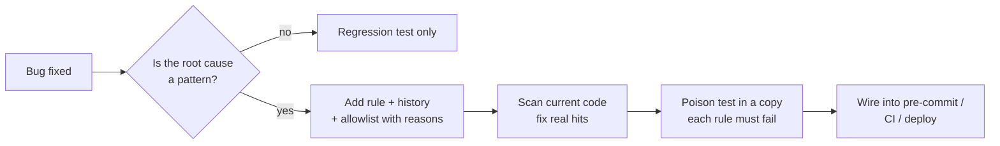

# bug-to-rule

**English** · [中文](README.zh-CN.md)

**Every bug you fix becomes a check, so the same mistake can't be merged again.**

  

A skill for coding agents. When a bug is fixed, the agent asks one question: *could this way of writing code show up again somewhere else?* If yes, it adds a rule to the project's rules file, scans the existing code with it, breaks the rule on purpose in a copy to prove it bites, and wires it into a gate that runs on every commit or deploy.

Notes and memory only remind. A rule blocks.

---

## Why

AI-assisted codebases grow fast, and the same mistake gets written again in a new file a week later. Fixing each instance doesn't scale. Turning the *pattern* into a test does, and it costs one small file per project.

The first scan is where it pays off. On its first run in two production codebases it found:

- a job that read local wall-clock times as UTC and a date format it could not parse, so hundreds of records had been labelled with the wrong outcome;
- a margin test with a hand-written list of providers, so a new provider about to be merged would have skipped the profit check entirely;
- a rule file of our own whose directory walk dropped subfolders, which made four rules pass silently. The poison test caught it.

---

## How it works



---

## Ground rules

1. **One rules file, the project's own test runner.** No new tools or dependencies.
2. **Every rule says which incident it prevents** and how to fix a violation.
3. **Exceptions are listed with a reason.** Patterns are never loosened to make old code pass.
4. **Coverage checks derive the full set from the source of truth**, never from a hand-written list.
5. **A self-check proves the scan sees code.** A broken walk makes every rule pass.
6. **Every rule is poison-tested** in a copy, never in a working tree that production runs from.
7. **Rules run automatically**: pre-commit, CI or the deploy script's test step.
8. **Production data cleanup after a bug is asked for, never assumed.**

---

## Install

Any coding agent that loads `SKILL.md` skills can use it.

```bash
git clone https://github.com/howardchenghuang-dotcom/bug-to-rule.git
# Claude Code
ln -s "$PWD/bug-to-rule" ~/.claude/skills/bug-to-rule
# Codex
ln -s "$PWD/bug-to-rule" ~/.codex/skills/bug-to-rule
```

To make it a habit in every project, add this to your global agent instructions (for example `~/.claude/CLAUDE.md` or `AGENTS.md`):

```markdown
After fixing a bug, ask whether the root cause is a pattern that could be written again elsewhere.
If yes, use the bug-to-rule skill. If no, a regression test is enough. Say which you chose.
```

## Use

- After a fix: *"turn this into a rule"*, *"never again"*.
- For a whole project: *"go through our past incidents and turn them into checks"*.

---

## Files

```
SKILL.md                      the workflow the agent follows (English, authoritative)
SKILL.zh-CN.md                Chinese translation
templates/test_repo_rules.py  starter rules file for Python (unittest / pytest)
templates/repo-rules.test.mjs starter rules file for Node (node:test)
```

The templates contain example rules (local time pinned to UTC, state in `/tmp`, tests touching production paths, paid APIs called outside their module, test runs piped into `tail`). Keep only the ones that match a real incident in your project.

## Limits

- Rules match how code is written, not what it means. They catch the patterns you name, not new kinds of bugs.
- Some incidents can't be checked statically (they need a live API or production data). The skill names those instead of writing weak rules.
- Regex rules can false-positive on strings or docs. Narrow the pattern or allowlist with a reason.

## Changelog

- **1.0.0** · First public release: workflow, Python and Node templates, Chinese translation.

## License

[MIT](LICENSE)
