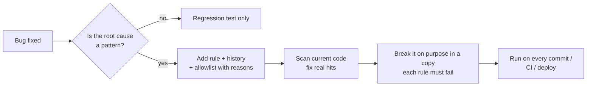

# bug-to-rule

**English** · [中文](README.zh-CN.md)

### Your AI will write the same bug twice. Make the second time impossible.

  

You fix a bug. A week later the same mistake shows up in a new file, written by you, a teammate or a coding agent. **bug-to-rule** turns each fix into a check, so the next copy fails a test before it can be merged.

---

## 30 seconds: one bug, one rule

A job decides whether a ride's pickup time has passed. Supplier times have no timezone and are in the **city's** local time, but the code reads them as UTC:

```python
# app/reconcile.py
pickup = datetime.fromisoformat(pickup_at)
if pickup.tzinfo is None:
    pickup = pickup.replace(tzinfo=timezone.utc)     # 15:00 in Los Angeles read as 15:00 UTC
```

In Los Angeles that is 8 hours off, so a ride cancelled the morning before pickup was recorded as *completed*. You fix this file. The skill then adds a rule so **no file** can do it again:

```python
# tests/test_repo_rules.py
def test_naive_local_time_not_pinned_to_utc(self):
    found = hits(r"\.replace\(\s*tzinfo\s*=\s*(timezone\.)?(utc|UTC)\b", source_files())
    self.assertEqual(without(found, self.ALLOW), [],
                     "attach the real local zone with the project's helper instead")
```

Next time anyone writes it, anywhere:

```
$ pytest tests/test_repo_rules.py -q
E   AssertionError: Lists differ: ['app/reconcile.py:7: pickup = pickup.replace(tzinfo=timezone.utc)'] != []
E   + [] : attach the real local zone with the project's helper instead
FAILED tests/test_repo_rules.py::TimeRules::test_naive_local_time_not_pinned_to_utc
1 failed, 4 passed in 0.02s
```

The fix the rule points to:

```python
pickup = pickup.replace(tzinfo=ZoneInfo(city_tz))
```

```
5 passed in 0.01s
```

That output is real: it is the starter template from this repo run against the code above.

---

## Try it in your project

```bash
# 1. Copy the starter rules file (Python shown; Node: templates/repo-rules.test.mjs)
curl -sO https://raw.githubusercontent.com/howardchenghuang-dotcom/bug-to-rule/main/templates/test_repo_rules.py
mkdir -p tests && mv test_repo_rules.py tests/

# 2. Run it against the code you already have
pytest tests/test_repo_rules.py -q

# 3. Every red line is either a live bug or an exception you explain in the allowlist
```

Then install the skill so your coding agent adds a rule after every fix (see [Install](#install)).

---

## What the first scan finds

The first run on existing code is where it pays off. In two production codebases it found:

- **Wrong outcomes on hundreds of records.** A job read local times as UTC and could not parse one supplier's date format, so cancelled and completed orders were mixed up. The rule found it on day one; the code was fixed and the data relabelled.
- **A profit check that would silently skip a new provider.** The margin test had a hand-written list of providers, and a branch about to be merged added a new one. Now the list comes from the price table, so a provider without a cost entry fails.
- **Our own rules passing for nothing.** The directory walk dropped subfolders, so four rules checked zero files. Breaking each rule on purpose in a copy caught it, which is why every rules file now starts with a "the scan sees code" check.

---

## How the skill works

After a fix, the agent asks one question: *could this way of writing code show up again in another file?*



Notes and memory only remind. A rule blocks.

### Ground rules

1. **One rules file, the project's own test runner.** No new tools or dependencies.
2. **Every rule says which incident it prevents** and how to fix a violation.
3. **Exceptions are listed with a reason.** Patterns are never loosened to make old code pass.
4. **Coverage checks derive the full set from the source of truth**, never from a hand-written list.
5. **A self-check proves the scan sees code.** A broken walk makes every rule pass.
6. **Every rule is broken on purpose once**, in a copy, never in a working tree that production runs from.
7. **Rules run automatically**: pre-commit, CI or the deploy script's test step.
8. **Cleaning up production data after a bug is asked for, never assumed.**

---

## Install

Works with any coding agent that loads `SKILL.md` skills.

```bash
git clone https://github.com/howardchenghuang-dotcom/bug-to-rule.git
# Claude Code
ln -s "$PWD/bug-to-rule" ~/.claude/skills/bug-to-rule
# Codex
ln -s "$PWD/bug-to-rule" ~/.codex/skills/bug-to-rule
```

To make it a habit in every project, add this to your global agent instructions (for example `~/.claude/CLAUDE.md` or `AGENTS.md`):

```markdown
After fixing a bug, ask whether the root cause is a pattern that could be written again elsewhere.
If yes, use the bug-to-rule skill. If no, a regression test is enough. Say which you chose.
```

Then just say *"turn this into a rule"* after a fix, or *"go through our past incidents and turn them into checks"* for a whole project.

---

## Files

```
SKILL.md                      the workflow the agent follows (English, authoritative)
SKILL.zh-CN.md                Chinese translation
templates/test_repo_rules.py  starter rules file for Python (unittest / pytest)
templates/repo-rules.test.mjs starter rules file for Node (node:test)
```

The templates ship with example rules: local time pinned to UTC, state files in `/tmp`, tests touching production paths, paid APIs called outside their module, test runs piped into `tail`. Keep only the ones that match a real incident in your project.

## Limits

- Rules match how code is written, not what it means. They catch the patterns you name, not new kinds of bugs.
- Some incidents can't be checked statically (they need a live API or production data). The skill names those instead of writing weak rules.
- Regex rules can match strings or docs by mistake. Narrow the pattern or allowlist with a reason.

## Changelog

- **1.0.1** · README opens with a real before/after and a three-step start.
- **1.0.0** · First public release: workflow, Python and Node templates, Chinese translation.

## License

[MIT](LICENSE)
