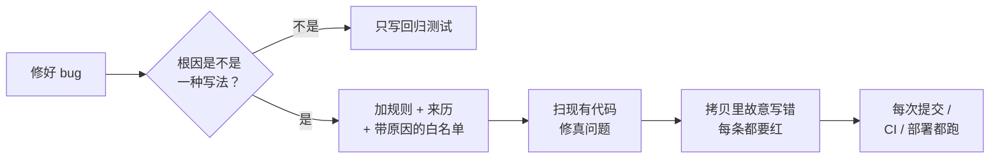

# bug-to-rule

[English](README.md) · **中文**

### 你的 AI 会把同一个 bug 写两遍。让第二遍写不出来。

  

> 中文版仅供参考，以英文版为准。

你修好一个 bug，一周后同样的错又出现在新文件里，可能是你写的、同事写的，也可能是编程智能体写的。**bug-to-rule** 把每次修复变成一条检查，下一次再这么写，测试直接红，合不进来。

---

## 30 秒看懂：一个 bug，一条规则

一个任务要判断接客时间过没过。供应商给的时间不带时区，是**城市当地**时间，代码却当成了 UTC：

```python
# app/reconcile.py
pickup = datetime.fromisoformat(pickup_at)
if pickup.tzinfo is None:
    pickup = pickup.replace(tzinfo=timezone.utc)     # 洛杉矶 15:00 被读成 UTC 15:00
```

在洛杉矶差 8 小时：接客当天上午取消的单，被记成了「已完成」。你修好这个文件，技能再加一条规则，让**任何文件**都不能再这么写：

```python
# tests/test_repo_rules.py
def test_naive_local_time_not_pinned_to_utc(self):
    found = hits(r"\.replace\(\s*tzinfo\s*=\s*(timezone\.)?(utc|UTC)\b", source_files())
    self.assertEqual(without(found, self.ALLOW), [],
                     "attach the real local zone with the project's helper instead")
```

下次谁在哪里再这么写：

```
$ pytest tests/test_repo_rules.py -q
E   AssertionError: Lists differ: ['app/reconcile.py:7: pickup = pickup.replace(tzinfo=timezone.utc)'] != []
E   + [] : attach the real local zone with the project's helper instead
FAILED tests/test_repo_rules.py::TimeRules::test_naive_local_time_not_pinned_to_utc
1 failed, 4 passed in 0.02s
```

按规则提示改：

```python
pickup = pickup.replace(tzinfo=ZoneInfo(city_tz))
```

```
5 passed in 0.01s
```

上面的输出是真实的：就是这个仓库的起步模板对上面的代码跑出来的。

---

## 在你的项目里试

```bash
# 1. 拷起步规则文件（这里是 Python；Node 用 templates/repo-rules.test.mjs）
curl -sO https://raw.githubusercontent.com/howardchenghuang-dotcom/bug-to-rule/main/templates/test_repo_rules.py
mkdir -p tests && mv test_repo_rules.py tests/

# 2. 对现有代码跑一遍
pytest tests/test_repo_rules.py -q

# 3. 每条红线，要么是线上 bug，要么是你在白名单里写明原因的例外
```

再把技能装上，让编程智能体每次修完 bug 都加规则（见[安装](#安装)）。

---

## 第一次扫能扫出什么

收益在第一次对现有代码跑。在两个线上项目里扫出了：

- **几百条记录的结果标错了。** 一个任务把当地时间当 UTC，还解析不了某家供应商的日期格式，取消和完成的单混在一起。规则第一天就扫出来，代码修好、数据改正。
- **利润检查会悄悄跳过新供应商。** 利润测试手写了供应商清单，一个即将合并的分支加了新的一家。现在清单从价目表取，漏写成本就红。
- **我们自己的规则在空转。** 遍历漏了子目录，四条规则查的是零个文件。在拷贝里逐条故意写错时抓了出来，所以现在每个规则文件开头都有一条「真的扫到了代码」的自检。

---

## 技能怎么工作

修完 bug，智能体先问一个问题：*这种写法换个文件还会再写出来吗？*



笔记和记忆只能提醒，规则能拦住。

### 铁律

1. **一个规则文件，用项目自己的测试工具。** 不加新工具、新依赖。
2. **每条规则写明防哪次事故**，以及违反了该怎么改。
3. **例外写进白名单并写原因。** 不许为了让老代码通过把规则改松。
4. **覆盖检查从唯一来源取全集**，不手写清单。
5. **自检证明真的扫到了代码。** 遍历坏了，所有规则都会过。
6. **每条规则都故意写错验证一次**，在拷贝里做，不在线上直接运行的工作区里做。
7. **规则自动跑**：pre-commit、CI 或部署脚本的测试步骤。
8. **bug 之后要改线上数据，先问，不默认去改。**

---

## 安装

支持 `SKILL.md` 技能的编程智能体都能用。

```bash
git clone https://github.com/howardchenghuang-dotcom/bug-to-rule.git
# Claude Code
ln -s "$PWD/bug-to-rule" ~/.claude/skills/bug-to-rule
# Codex
ln -s "$PWD/bug-to-rule" ~/.codex/skills/bug-to-rule
```

想在所有项目里养成习惯，把下面这段加进全局的智能体说明（比如 `~/.claude/CLAUDE.md` 或 `AGENTS.md`）：

```markdown
修完 bug 先判断根因是不是一种换个文件还会再写出来的写法。
是就用 bug-to-rule 技能；不是写回归测试就够。说明选了哪个。
```

之后修完 bug 说一句 *「写成规则」*，或者对整个项目说 *「把我们过去的事故都变成检查」*。

---

## 文件

```
SKILL.md                      智能体照着走的流程（英文，权威版）
SKILL.zh-CN.md                中文翻译
templates/test_repo_rules.py  Python 规则文件起步模板（unittest / pytest）
templates/repo-rules.test.mjs Node 规则文件起步模板（node:test）
```

模板自带示例规则：当地时间当 UTC、状态文件放 `/tmp`、测试碰生产路径、付费接口在自己模块外调用、跑测试接 `tail`。只留跟你项目真实事故对得上的。

## 局限

- 规则匹配的是写法，不是含义。只能抓你点名的写法，抓不到新类型的 bug。
- 有的事故没法静态检查（要调真接口或看线上数据），技能会说明，不写凑数的规则。
- 正则规则可能误伤字符串或文档。收窄规则，或写原因进白名单。

## 更新记录

- **1.0.1** · README 开头改成真实的前后对照和三步上手。
- **1.0.0** · 首个公开版本：流程、Python 和 Node 模板、中文翻译。

## 许可证

[MIT](LICENSE)
