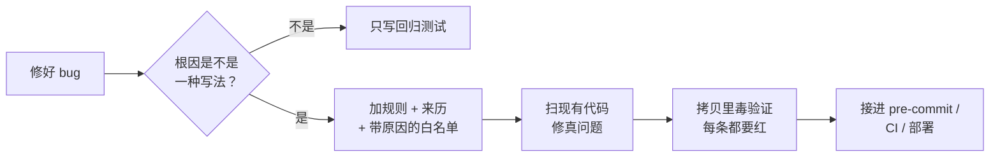

# bug-to-rule

[English](README.md) · **中文**

**修好的每个 bug 都变成一条检查，同样的错以后合不进来。**

  

> 中文版仅供参考，以英文版为准。

给编程智能体用的技能。修完一个 bug，它先问一个问题：*这种写法换个文件还会再写出来吗？* 会，就往项目的规则文件里加一条，用它扫一遍现有代码，在拷贝里故意写错证明它真能拦住，再接进每次提交或部署都会跑的关口。

笔记和记忆只能提醒，规则能拦住。

---

## 为什么

用 AI 写代码，代码长得快，同一个错一周后又在新文件里写一遍。一个个修跟不上，把*写法*变成测试才跟得上，每个项目只多一个小文件。

收益在第一次扫。在两个线上项目第一次跑就扫出了：

- 一个任务把当地时间当 UTC，还有一种日期格式解析不了，几百条记录的结果标错了；
- 利润测试里手写了供应商清单，一个即将合并的新供应商会整个跳过利润检查；
- 我们自己写的规则文件，遍历漏了子目录，四条规则悄悄全过。是毒验证抓出来的。

---

## 流程



---

## 铁律

1. **一个规则文件，用项目自己的测试工具。** 不加新工具、新依赖。
2. **每条规则写明防哪次事故**，以及违反了该怎么改。
3. **例外写进白名单并写原因。** 不许为了让老代码通过把规则改松。
4. **覆盖检查从唯一来源取全集**，不手写清单。
5. **自检证明真的扫到了代码。** 遍历坏了，所有规则都会过。
6. **每条规则都做毒验证**，在拷贝里做，不在线上直接运行的工作区里做。
7. **规则自动跑**：pre-commit、CI 或部署脚本的测试步骤。
8. **bug 之后要改线上数据，先问，不默认去改。**

---

## 安装

支持 `SKILL.md` 技能的编程智能体都能用。

```bash
git clone https://github.com/howardchenghuang-dotcom/bug-to-rule.git
# Claude Code
ln -s "$PWD/bug-to-rule" ~/.claude/skills/bug-to-rule
# Codex
ln -s "$PWD/bug-to-rule" ~/.codex/skills/bug-to-rule
```

想在所有项目里养成习惯，把下面这段加进全局的智能体说明（比如 `~/.claude/CLAUDE.md` 或 `AGENTS.md`）：

```markdown
修完 bug 先判断根因是不是一种换个文件还会再写出来的写法。
是就用 bug-to-rule 技能；不是写回归测试就够。说明选了哪个。
```

## 使用

- 修完一个 bug：*「写成规则」*、*「别再犯」*。
- 整个项目：*「把我们过去的事故都变成检查」*。

---

## 文件

```
SKILL.md                      智能体照着走的流程（英文，权威版）
SKILL.zh-CN.md                中文翻译
templates/test_repo_rules.py  Python 规则文件起步模板（unittest / pytest）
templates/repo-rules.test.mjs Node 规则文件起步模板（node:test）
```

模板里有示例规则（当地时间当 UTC、状态放 `/tmp`、测试碰生产路径、付费接口在自己模块外调用、跑测试接 `tail`）。只留跟你项目真实事故对得上的。

## 局限

- 规则匹配的是写法，不是含义。只能抓你点名的写法，抓不到新类型的 bug。
- 有的事故没法静态检查（要调真接口或看线上数据），技能会说明，不写凑数的规则。
- 正则规则可能误伤字符串或文档。收窄规则，或写原因进白名单。

## 更新记录

- **1.0.0** · 首个公开版本：流程、Python 和 Node 模板、中文翻译。

## 许可证

[MIT](LICENSE)
